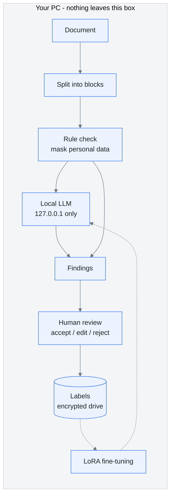

<p align="center"></p>

# Govdoc Agent

**A local AI agent that reviews government project documents without sending a single byte off your PC.**

[](https://github.com/Mirotoc/Govdoc-agent/actions/workflows/build.yml)


> **Vibe-coded.** I built this project by directing an AI coding agent (Claude Code) in plain language: I set the goals, constraints, and quality bar, and the agent wrote and tested the code with me.
> This is my first public vibe-coding project. The full build log, including the prompts that shaped it and the bugs we hit along the way, is in [docs/VIBE_CODING.md](docs/VIBE_CODING.md).

<br>

## The problem

Government project documents (R&D proposals, project plans, final reports) contain budgets, partner details, personal information, and unpublished technical content.
Pasting them into a cloud AI service sends that data to an external server, which can break security rules for public institutions and create legal risk.

So the project starts from one rule:

> **Documents never leave the PC.**

- The language model is installed and run on the user's own machine.
- Review, labeling, and fine-tuning all happen on that machine or inside the organization's closed network.
- The internet is needed only once, to download the model.

<br>

## What it does

| Step | What happens | Status |
|---|---|---|
| Read | Splits a document into numbered paragraph blocks | Done (plain text) |
| Rule check | Finds and masks resident registration numbers and phone numbers, flags reversed date ranges | Done |
| AI review | A local LLM checks totals, spelling, terminology, and missing items | Done (via Ollama) |
| Labeling | A reviewer accepts, edits, or rejects each finding; every decision is saved as training data | Done (terminal) |
| Fine-tuning | Labels are used to adapt the model to an organization's documents with LoRA | Config draft |
| Screen capture | Read screenshots and scanned pages with a multimodal model | Planned |

The AI only **suggests**. A person always makes the final call.

<br>

## How it works



- Personal data is masked **before** anything is sent to the model.
- The only network address in the code is `127.0.0.1`. There is no setting that could point it anywhere else.

<br>

## Code tour

Standard C++17 only, no third-party libraries. 378 lines in total, and each file does one job.

| File | Responsibility | Lines |
|---|---|---|
| [`src/core.hpp`](src/core.hpp) | Data types (`Block`, `Issue`) and every function signature | 32 |
| [`src/main.cpp`](src/main.cpp) | Program flow: read, rules, AI, print, label | 53 |
| [`src/document.cpp`](src/document.cpp) | Splits a text document into paragraph blocks | 29 |
| [`src/rules.cpp`](src/rules.cpp) | Regex checks for personal data and reversed dates | 34 |
| [`src/llm.cpp`](src/llm.cpp) | Talks to the local Ollama server over a raw socket and parses the reply | 82 |
| [`src/label.cpp`](src/label.cpp) | Collects accept / edit / reject decisions and writes JSONL | 47 |
| [`src/text.cpp`](src/text.cpp) | Minimal JSON string handling and splitting | 75 |
| [`tests/rules_test.cpp`](tests/rules_test.cpp) | Tests for rules, masking, and parsing | 26 |

New to the code? Read `core.hpp`, then `main.cpp`. That is the whole program flow in under 90 lines.

Why no libraries? Fewer dependencies mean fewer things a security reviewer has to audit, and this tool is meant for environments where every installed component needs approval.

<br>

## Try it

**1. Build** (CMake and any C++17 compiler)

```bash
cmake -S . -B build
cmake --build build --config Release
ctest --test-dir build -C Release
```

**2. Run the rule check** (no AI needed)

```bash
build/Release/govdoc samples/sample_plan_en.txt --rules-only
```

**3. Connect the local model** (internet needed once, for the download)

```bash
ollama pull qwen3.5:4b
ollama create govdoc-reviewer -f models/Modelfile
build/Release/govdoc samples/sample_plan_en.txt
```

**4. Review the findings and save them as labels**

```bash
build/Release/govdoc samples/sample_plan_en.txt --label
```

On Linux and macOS the binary is at `build/govdoc`.

<details>
<summary>Sample output</summary>

```
Found 6 item(s) to review.
These are suggestions. You make the final call.

[p2] DATE (high)
  evidence:   2027.03.01 ~ 2026.12.31
  suggestion: Check the end date
  reason:     The end date is earlier than the start date
  source:     rules

[p4] PII (critical)
  evidence:   900101-*******
  suggestion: Remove the resident registration number
  reason:     A resident registration number is exposed
  source:     rules

[p3] AMOUNT (critical)
  evidence:   ... a government grant of KRW 100,000 thousand and an institutional contribution of KRW 40,000 thousand
  suggestion: ... adjust the components to add up to 150,000 thousand
  reason:     The sum of the government grant and institutional contribution equals 140,000 thousand,
              but the total budget is stated as 150,000 thousand.
  source:     govdoc-test

[p5] SPELL (medium)
  evidence:   the the
  suggestion: Change to "the"
  reason:     The word "the" is repeated.
  source:     govdoc-test
```

This is a real run on the fictional sample, using Qwen3 4B as a stand-in for Qwen3.5 (shortened for readability).
The `source` field shows whether a finding came from the deterministic rules or from the model.

</details>

<br>

## Why a small Qwen model

Most government project documents run from a few pages to a few dozen pages. A huge model is not needed.

- **Qwen3.5 Small** (0.8B, 2B, 4B, 9B) is Apache-2.0 licensed, so commercial use is allowed. It handles text and images, so the same model can later read screenshots.
- 4B is the recommended size for an office PC with an 8 GB GPU. 2B works on a laptop without a GPU.
- Any Ollama model can be swapped in with `--model name`.

<br>

## Built with compliance in mind

The design follows these standards and regulations from day one, so the tool does not create legal problems later. Details are in the [compliance checklist](docs/COMPLIANCE.md).

| Area | Reference |
|---|---|
| International standards | ISO/IEC 27001 (information security), 27701 (privacy), 42001 (AI management), 23894 (AI risk), 5259 (AI data quality) |
| Korean law | Personal Information Protection Act, AI Basic Act (in force since 2026-01-22) |
| Public-sector security | NIS National Network Security Framework (N2SF) and each institution's security guidelines |

> This is not legal advice. Any real deployment needs a review by the institution's security officer and legal team.

<br>

## Known limitations

Being honest about what does not work yet:

- Input is plain text only. HWP, HWPX, and PDF need to be converted first.
- The rule check covers only resident registration numbers, mobile numbers, and date ranges.
- Small models miss things. In testing, Qwen3 4B caught the spelling error in the English sample but missed the one in the Korean sample. Fine-tuning on labels is meant to close that gap.
- Hardware figures in the docs are estimates and have not been measured yet.

<br>

## Documentation

| Document | Contents |
|---|---|
| [Vibe coding log](docs/VIBE_CODING.md) | How the project was built with an AI agent, prompt by prompt |
| [Architecture](docs/ARCHITECTURE.md) | Processing stages and how data leakage is prevented |
| [Compliance checklist](docs/COMPLIANCE.md) | ISO standards and Korean regulations, mapped to the design |
| [Roadmap](docs/ROADMAP.md) | What comes next |
| [Label schema](labeling/label_schema.json) | Error types and reviewer verdicts |
| [Agent rules](CLAUDE.md) | Instructions any AI coding agent must follow in this repository |
| [Changelog](CHANGELOG.md) | Version history |

<br>

---

<sub>Vibe-coded with Claude Code. All sample data is fictional. No real documents or personal data are ever committed to this repository.</sub>
