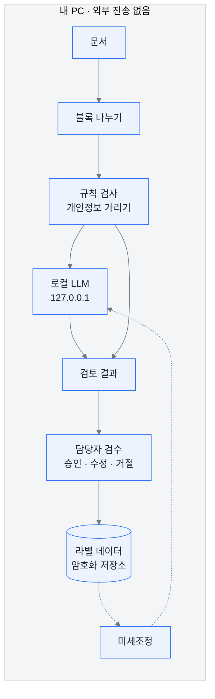

<p align="center"></p>

# Govdoc Agent

<sub>Local AI-powered Government Document Review & Editing Agent</sub>

**정부사업 문서를 내 PC 안에서만 검토하는 AI예요.**
문서를 인터넷으로 보내지 않고, 내 PC에 설치한 작은 언어모델(로컬 LLM)로 오류를 찾고 고칠 방법을 제안해요.

> 🤖 **바이브 코딩으로 만든 프로젝트예요.** AI 코딩 도구(Claude Code)와 대화하며 설계하고 구현했어요.
> 제가 바이브 코더로서 처음 시작하는 프로젝트이고, 지금은 **아이디어 구상과 첫 프로토타입** 단계예요.

<br>

## 왜 만들었나요

정부사업 문서에는 사업비, 참여기관, 개인정보, 공개되지 않은 기술 내용이 들어 있어요.
이런 문서를 클라우드 AI에 올리면 데이터가 외부 서버로 넘어가고, 보안 규정을 어길 수 있어요.

그래서 원칙을 하나 정했어요.

> **문서는 PC 밖으로 나가지 않아요.**

- AI 모델을 내 PC에 직접 설치해서 써요.
- 검토, 라벨링, 학습을 모두 PC 안(또는 기관 내부망)에서 해요.
- 인터넷은 처음 모델을 내려받을 때만 써요.

<br>

## 무엇을 하나요

| 단계 | 하는 일 | 상태 |
|---|---|---|
| 읽기 | 문서를 문단 단위 블록으로 나눠요 | ✅ 텍스트 파일 지원 |
| 규칙 검사 | 주민등록번호와 휴대전화 번호를 찾아 가리고, 거꾸로 적힌 기간을 찾아요 | ✅ |
| AI 검토 | 금액 합계, 맞춤법, 용어, 누락된 항목을 로컬 LLM이 검토해요 | ✅ Ollama 연동 |
| 라벨링 | 담당자가 AI 제안을 승인·수정·거절하면 학습 데이터로 저장돼요 | ✅ 터미널에서 |
| 학습 | 쌓인 라벨로 모델을 우리 기관 문서에 맞게 미세조정해요 | 🔜 설정 초안 |
| 화면 인식 | 화면 캡처나 스캔본을 멀티모달 모델로 읽어요 | 🔜 계획 |

AI는 **제안만 해요.** 최종 판단은 언제나 담당자가 해요.

<br>

## 어떻게 동작하나요



- 개인정보는 **AI에 보내기 전에** 먼저 가려요.
- 프로그램은 `127.0.0.1`(내 PC)에만 접속하도록 코드에 고정되어 있어요. 다른 주소로 바꾸는 설정 자체가 없어요.

<br>

## 코드 둘러보기

외부 라이브러리 없이 **표준 C++17**로만 짰어요. 전체 370줄이고, 파일 하나가 한 가지 일만 해요.

| 파일 | 하는 일 | 줄 수 |
|---|---|---|
| [`src/core.hpp`](src/core.hpp) | 데이터 구조(`Block`, `Issue`)와 함수 목록 | 31 |
| [`src/main.cpp`](src/main.cpp) | 실행 흐름: 읽기 → 규칙 → AI → 출력 → 라벨링 | 52 |
| [`src/document.cpp`](src/document.cpp) | 텍스트 문서를 문단 블록으로 나누기 | 29 |
| [`src/rules.cpp`](src/rules.cpp) | 정규식으로 개인정보와 기간 오류 찾기 | 31 |
| [`src/llm.cpp`](src/llm.cpp) | 소켓으로 로컬 Ollama에 요청하고 응답 해석 | 82 |
| [`src/label.cpp`](src/label.cpp) | 승인·수정·거절을 받아 JSONL로 저장 | 47 |
| [`src/text.cpp`](src/text.cpp) | JSON 문자열 처리, 문자열 나누기 | 75 |
| [`tests/rules_test.cpp`](tests/rules_test.cpp) | 규칙 검사와 JSON 처리 테스트 | 23 |

처음 보는 분은 `core.hpp` → `main.cpp` 순서로 읽으면 전체 흐름을 바로 볼 수 있어요.

<br>

## 실행해 보기

**1. 빌드해요** (CMake, C++17 컴파일러)

```bash
cmake -S . -B build
cmake --build build --config Release
ctest --test-dir build -C Release
```

**2. 규칙 검사만 해 봐요** (AI 없이도 돼요)

```bash
build/Release/govdoc samples/sample_plan.txt --rules-only
```

**3. 로컬 AI를 연결해요** (처음 한 번만 인터넷이 필요해요)

```bash
ollama pull qwen3.5:4b
ollama create govdoc-reviewer -f models/Modelfile
build/Release/govdoc samples/sample_plan.txt
```

**4. 결과를 검수하고 라벨로 저장해요**

```bash
build/Release/govdoc samples/sample_plan.txt --label
```

<details>
<summary>실행 결과 예시 보기</summary>

```
확인이 필요한 곳을 4개 찾았어요.
AI가 만든 제안이에요. 최종 판단은 담당자가 해 주세요.

[p2] DATE (high)
  근거: 2027.03.01 ~ 2026.12.31
  제안: 종료일을 확인해 주세요
  이유: 종료일이 시작일보다 빨라요

[p4] PII (critical)
  근거: 900101-*******
  제안: 주민등록번호를 지워 주세요
  이유: 주민등록번호가 그대로 보여요

[p4] PII (critical)
  근거: 010-****-****
  제안: 개인 연락처를 가려 주세요
  이유: 휴대전화 번호가 그대로 보여요

[p3] AMOUNT (high)
  근거: … 정부출연금 100,000천원, 기관부담금 40,000천원으로 구성된다.
  제안: … 기관부담금 50,000천원으로 구성된다.
  이유: 구성 금액 합계가 총사업비와 달라요
```

예시 문서는 가상으로 만든 문서예요. 위 결과는 Qwen3 4B로 실제로 실행한 결과예요.
이 모델은 맞춤법 오류(`있을것으로`)는 아직 찾지 못했어요. 라벨링과 미세조정으로 보완할 부분이에요.

</details>

<br>

## 왜 작은 Qwen 모델인가요

정부사업 문서는 대부분 수 쪽에서 수십 쪽 분량이에요. 아주 큰 모델은 필요하지 않아요.

- **Qwen3.5 Small** (0.8B · 2B · 4B · 9B): Apache-2.0 라이선스라 상업적으로도 쓸 수 있어요. 텍스트와 이미지를 함께 처리해서 나중에 화면 인식도 같은 모델로 할 수 있어요.
- GPU가 8GB인 사무용 PC라면 **4B**, GPU가 없는 노트북이라면 **2B**를 권장해요.
- 모델 이름만 바꾸면 다른 모델로 교체할 수 있어요 (`--model 이름`).

<br>

## 법과 표준을 지켜요

나중에 법적 문제가 생기지 않도록 처음부터 아래 기준을 참고해서 설계해요. 자세한 내용은 [준수 체크리스트](docs/COMPLIANCE.md)에 있어요.

| 구분 | 기준 |
|---|---|
| 국제 표준 | ISO/IEC 27001 정보보안 · 27701 개인정보 · 42001 AI 경영 · 23894 AI 위험관리 · 5259 AI 데이터 품질 |
| 국내 법령 | 개인정보 보호법 · 인공지능기본법(2026.1.22 시행) |
| 공공 보안 | 국가정보원 국가망보안체계(N²SF) · 소속 기관 보안 지침 |

> 이 문서는 법률 자문이 아니에요. 실제 기관에 도입하기 전에는 보안담당관과 법무 검토를 꼭 받아야 해요.

<br>

## 더 알아보기

| 문서 | 내용 |
|---|---|
| [아키텍처](docs/ARCHITECTURE.md) | 처리 단계와 데이터 유출을 막는 방법 |
| [준수 체크리스트](docs/COMPLIANCE.md) | ISO와 국내 법령 대응표 |
| [디자인 원칙](docs/DESIGN.md) | KRDS와 토스 라이팅 원칙 적용 방식 |
| [로드맵](docs/ROADMAP.md) | 단계별 계획 |
| [라벨 체계](labeling/label_schema.json) | 오류 유형과 판정 기준 |

<br>

---

<sub>🤖 Vibe-coded with Claude Code · 예시 데이터는 모두 가상이에요 · 실제 문서와 개인정보는 이 저장소에 올리지 않아요</sub>
