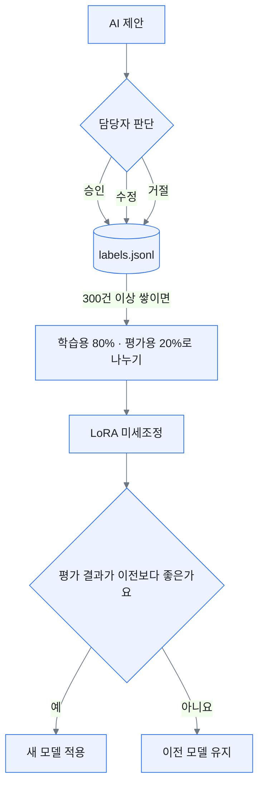

# 아키텍처

## 설계 원칙

| 원칙 | 의미 |
|---|---|
| 외부 전송 없음 | 문서, 결과, 라벨이 PC 밖으로 나가지 않아요 |
| 사람이 결정 | AI는 제안하고, 담당자가 판단해요. 판단은 모두 기록돼요 |
| 규칙과 AI의 분담 | 정확해야 하는 검사는 규칙이, 문맥 판단은 AI가 맡아요 |
| 최소 의존성 | 표준 C++만 써요. 외부 라이브러리가 적을수록 점검할 곳도 적어요 |

 

## 처리 단계

| 단계 | 파일 | 하는 일 | 보안 포인트 |
|---|---|---|---|
| ① 읽기 | `document.cpp` | 문서를 빈 줄 기준으로 블록(`p1`, `p2` …)으로 나눠요 | 원본은 읽기만 해요 |
| ② 규칙 검사 | `rules.cpp` | 주민등록번호, 휴대전화 번호, 거꾸로 적힌 기간을 찾아요 | 찾은 개인정보는 가린 상태로만 보여 줘요 |
| ③ AI 검토 | `llm.cpp` | 개인정보를 가린 문서를 로컬 Ollama에 보내요 | 접속 주소가 `127.0.0.1`로 고정돼 있어요 |
| ④ 결과 해석 | `llm.cpp` | `블록|유형|심각도|근거|수정안|이유` 형식의 줄만 받아요 | 형식이 틀린 줄과 중복은 버려요 |
| ⑤ 검수 | `label.cpp` | 승인 `a`, 수정 `e`, 거절 `r`을 입력받아요 | 검수 시각과 모델 버전을 함께 저장해요 |
| ⑥ 저장 | `data/labels.jsonl` | 라벨을 한 줄에 하나씩 저장해요 | `data/`는 git에서 제외하고 암호화 드라이브에 둬요 |
| ⑦ 학습 | `models/lora_finetune.yaml` | 쌓인 라벨로 LoRA 미세조정을 해요 | 오프라인으로 학습하고 외부 로깅은 꺼요 |

 

## 데이터 유출을 막는 방법

약속에 기대지 않고, 여러 겹으로 막은 뒤 실제로 막혔는지 확인해요.

1. **코드**: 접속 주소를 `127.0.0.1:11434`로 고정했어요. 외부 주소를 넣는 옵션이 없어요.
2. **순서**: 개인정보를 가린 뒤에 AI에게 보내요.
3. **네트워크**: Ollama를 `OLLAMA_HOST=127.0.0.1`로 실행하고, 모델을 받은 뒤에는 방화벽으로 외부 통신을 막아요.
4. **저장소**: `data/`는 BitLocker로 암호화한 드라이브에 두고 `.gitignore`로 저장소에서 제외해요.
5. **확인**: 실행 중에 `netstat -ano`로 외부 연결이 없는지 확인하고 결과를 기록해요.
6. **모델 출처**: 모델은 공식 배포처에서만 받고, 받은 파일의 해시값을 기록해요.

 

## 라벨링에서 학습까지

- 같은 문서를 두 명이 라벨링하고 결과가 얼마나 일치하는지 확인해요 (ISO/IEC 5259 참고).
- 거절된 제안도 저장해요. AI가 무엇을 잘못 짚는지 알려 주는 중요한 데이터예요.

 

## 권장 사양 (예상치)

| 환경 | 권장 모델 |
|---|---|
| GPU 없음, RAM 16GB | Qwen3.5 2B |
| GPU 8GB | Qwen3.5 4B |
| GPU 12GB 이상 | Qwen3.5 9B |

직접 측정한 뒤 갱신할 예정이에요.
