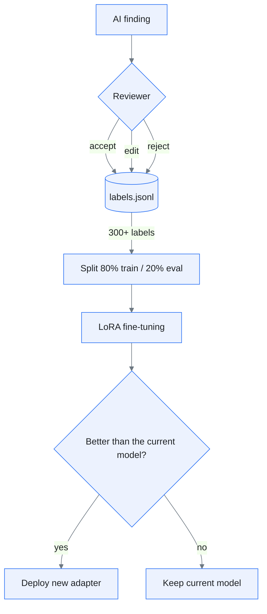

# Architecture

## Design principles

| Principle | What it means |
|---|---|
| Zero egress | Documents, findings, and labels never leave the PC |
| Human decides | The AI suggests, a reviewer decides, and every decision is recorded |
| Rules and AI split the work | Checks that must be exact go to rules; judgment calls go to the model |
| Minimal dependencies | Standard C++ only. Fewer components means less to audit |

 

## Processing stages

| Stage | File | What happens | Security point |
|---|---|---|---|
| 1. Read | `document.cpp` | Splits the document on blank lines into blocks `p1`, `p2`, and so on | The original file is only read, never modified |
| 2. Rule check | `rules.cpp` | Finds resident registration numbers, mobile numbers, and reversed date ranges | Personal data is shown only in masked form |
| 3. AI review | `llm.cpp` | Sends the masked document to the local Ollama server | The address is fixed to `127.0.0.1` |
| 4. Parse | `llm.cpp` | Accepts only lines in the form `block|type|severity|evidence|suggestion|reason` | Malformed lines and duplicates are dropped |
| 5. Review | `label.cpp` | The reviewer presses `a` to accept, `e` to edit, or `r` to reject | Each label stores its source and a timestamp |
| 6. Store | `data/labels.jsonl` | One label per line | `data/` is excluded from git and belongs on an encrypted drive |
| 7. Train | `models/lora_finetune.yaml` | LoRA fine-tuning on the collected labels | Offline training, external logging disabled |

 

## How leakage is prevented

Not by promise, but by several layers that can each be checked.

1. **Code**: The address `127.0.0.1:11434` is a constant. There is no option to change it.
2. **Order**: Personal data is masked before the model sees the text.
3. **Network**: Ollama runs with `OLLAMA_HOST=127.0.0.1`, and after the model download the firewall blocks outbound traffic.
4. **Storage**: `data/` lives on a BitLocker-encrypted drive and is excluded by `.gitignore`.
5. **Verification**: While the tool runs, `netstat -ano` should show no external connections, and the result is recorded.
6. **Model supply chain**: Models come only from official sources, and the file hash is recorded.

 

## From labels to training

- Two reviewers label the same documents, and their agreement is measured (see ISO/IEC 5259).
- Rejected findings are kept too. They show exactly where the model goes wrong.
- The `source` field separates rule findings from model findings, so only model output is used to judge the model.

 

## Hardware guide (estimates)

| Machine | Suggested model |
|---|---|
| No GPU, 16 GB RAM | Qwen3.5 2B |
| 8 GB GPU | Qwen3.5 4B |
| 12 GB GPU or more | Qwen3.5 9B |

These numbers are estimates and will be replaced with measurements.
